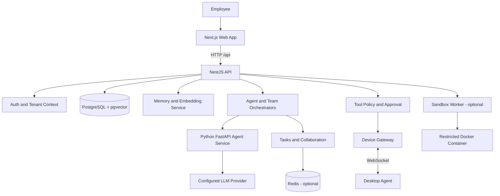

# System Architecture

## 1. Purpose and scope

AI Teammates is a multi-tenant platform for employees to configure AI agents with distinct roles, provider/model settings, permissions, memory namespaces, conversations and runs. The platform provides a web UI, a NestJS API, a Python agent runtime, persistence, optional Redis-based coordination, device execution and a sandbox-worker boundary.

This document explains the architecture represented by the repository. It is not a claim that every production hardening item is complete.

## 2. High-level component diagram

## 3. Component responsibilities

### 3.1 Web application — `apps/web`

- Built with Next.js App Router, React and TypeScript.
- Contains pages for dashboard, login, agent management, team chat, projects, tasks, memory, approvals, device management, collaboration and agent activity.
- Calls the API through client-side fetch helpers and uses the configured API base URL.
- The web app presents task and agent status; it is not the authority for authorization or tool execution.

Development default: `http://localhost:3000`. Next.js may select another port if 3000 is occupied; when that happens, the API CORS allowlist must include the actual browser origin.

### 3.2 Application API — `apps/api`

- NestJS application written in TypeScript.
- Uses a global `/api` prefix.
- Exposes health, authentication, organization, agent, project, task, memory, collaboration, approval, audit, tool, device, sandbox and orchestration endpoints.
- Owns tenant-aware data access, task records, approval state and device command lifecycle.
- Connects to PostgreSQL and optionally Redis.
- Calls the agent service for model/runtime work.

The API is the policy enforcement point. The language model can propose an action, but it must not be treated as the authority that grants access.

### 3.3 Agent service — `apps/agent-service`

- Python FastAPI service.
- Contains provider adapters for OpenAI, Anthropic and Gemini.
- Exposes health, response, tool-planning, delegated-task and memory helper endpoints.
- Uses configured provider/model values and environment keys.
- Returns a not-configured marker when an LLM key is absent; the API/runtime must interpret that result correctly.

Default health endpoint: `http://localhost:8000/health`.

### 3.4 Desktop agent — `apps/desktop-agent`

A local Node.js process connects to the API device WebSocket. It is intended to act on a configured workspace only when the device token and local policy permit it.

The runtime supports a constrained set of file and terminal actions and optional browser/screenshot capabilities. Terminal execution uses an executable allowlist and does not invoke a shell. File paths are checked against the configured workspace. These controls reduce risk but are not a replacement for OS isolation.

### 3.5 Sandbox worker — `apps/sandbox-worker`

A separate FastAPI service uses Docker Engine to run supported Python or Node snippets in short-lived containers with resource and privilege restrictions. It is a distinct execution boundary from the desktop agent. It requires Docker Engine and is not automatically started by the Docker-free Windows development script.

### 3.6 Persistence and infrastructure

- PostgreSQL is the primary persistent store.
- pgvector stores/searches embedding vectors for semantic memory.
- Redis is optional for local UI/API development but required for Redis-backed task streams and cross-process activity delivery.
- Docker Compose is available for supporting infrastructure and services.

## 4. Main request flows

### 4.1 Standard agent request

1. The employee submits a request through the web UI.
2. The browser calls an API endpoint with the application token.
3. The API resolves the authenticated employee and company context.
4. The API checks ownership, role, task context and relevant policy.
5. The API calls the agent service with the selected agent role, instructions, provider/model and conversation/memory context.
6. If the agent requests a tool, tool policy decides whether it is allowed or requires approval.
7. Execution results are recorded and returned to the web UI.

Exact steps differ by endpoint and tool; consult the source controller/service for a specific route.

### 4.2 Team chat request

1. The web page sends a message to `POST /api/orchestrator/team-run`.
2. The API validates the message and checks any selected project belongs to the company.
3. The orchestrator finds agents belonging to the current employee that have both `agent.chat` and `agent.collaborate` permissions.
4. It chooses stages based on the request and available roles: Coding, Testing and Documentation.
5. Each selected stage creates a task and invokes its assigned agent.
6. Output from one stage becomes contextual input for the next stage.
7. Missing specialists are reported as skipped. A failed stage or a stage waiting for human approval blocks subsequent work.
8. The workflow has a bounded repair path for reported test failures; it is not an unlimited autonomous loop.

See [Team Orchestration](TEAM_ORCHESTRATION.md).

### 4.3 Memory write/search

1. A memory request is scoped to an agent and a company/employee context.
2. The API applies memory policy and validates the requested scope.
3. For semantic operations, text is converted into a vector by the configured embedding provider.
4. The vector and associated metadata are persisted and used for similarity search.
5. Retrieved memories are filtered/scoped before being provided as context to an agent.

Current API embedding implementation requires `OPENAI_API_KEY` and defaults to `text-embedding-3-small`. A valid LLM provider key alone does not prove embeddings are configured.

### 4.4 Device command

1. The API records a device command and correlates it with device, agent and task context.
2. The device gateway delivers the command to the registered desktop runtime.
3. The desktop runtime checks the global action allowlist and optional agent-specific restrictions.
4. The runtime validates arguments and workspace paths, then executes only supported actions.
5. A result is sent back and the API finalizes the command state idempotently.

### 4.5 Human approval

A tool or task can be placed in a waiting state when approval is required. The approval UI allows a permitted user to approve or reject. Approval is not equivalent to a blanket permission grant; it applies to the associated execution/action and must be validated by the API.

## 5. Domain boundaries

Core domains visible in the API include:

- **Tenant and organization:** companies, employees, roles and departments.
- **Agents:** agent identity, role, instructions, provider/model and execution.
- **Projects and tasks:** work context, assignments, status and dependencies.
- **Conversations and messages:** persisted communication associated with agents/tasks.
- **Memory:** scope, content, embeddings and retrieval.
- **Tools and policy:** tool registry, tool execution records and approval requirements.
- **Approvals and audit:** human decisions and security-relevant events.
- **Devices:** registration, agent binding, commands and runtime results.
- **Orchestration:** routing and multi-stage coordination.

## 6. Reliability and failure semantics

- Health is reported by `GET /api/health`; database must be reachable. Redis may be reported as `disabled` and still yield an overall healthy result in local mode.
- If Redis is disabled, in-process activity events can work, but Redis-backed queues/streams and cross-process delivery do not.
- Provider credentials and model availability are separate concerns from API health.
- A team stage can be skipped because no matching specialist is configured, fail because the runtime or a provider fails, or wait for approval.
- Do not treat a task as complete just because a request returned HTTP success; inspect the stage/task status and actual tool results.

## 7. Production boundary

The repository contains substantial local runtime and policy controls, but public production deployment still requires a reviewed identity model, robust secret management, monitoring/alerting, backups/restore tests, deployment automation, security integration tests, and real-device/browser E2E testing. See [Security](SECURITY.md) and [Testing](TESTING.md).
